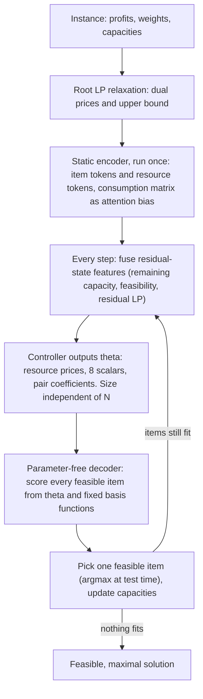

# Constraint-Aware RL for the Multi-dimensional Knapsack Problem: Progress Report

> **Branch:** `codex/t8-v6-executor-training-signals` (head `4d2d87e`) · **Snapshot date:** 2026-11-13
>
> **Sources:** the `docs/` folder (research handoff, T0 to T8 guidance and execution reports), the source code, and the local run artifacts of the current stage (`runs/t8_*`, `results/t8_port`). The last group matters: the written docs stop on 2026-11-09 and say the T8 training "has not been run", but both training runs have finished since then. Section 3.4 reports what is actually on disk.

**How to read the numbers in this report**

- **Gap** = 100 × (reference − our objective) / reference, in %. Lower is better. On the Chu and Beasley benchmark the reference is the best-known value. On our synthetic validation set the reference is a MILP solution from HiGHS with a 10 s limit (53 of the 128 instances are proven optimal, the other 75 are incumbents).
- **pp** = percentage points, used for the difference between two gaps. Differences are paired per instance, with a two-sided Wilcoxon test, not corrected for multiple comparisons.
- Unless a line says otherwise, every number is **one greedy trajectory per instance**: no sampling, no local search.
- Every training run is **single seed (1234)**. "Significant" therefore means "across test instances", never "across training seeds".

---

## 0. The short version

1. **What we are building.** A two-level policy. A learned controller reads the current residual problem and outputs a small, interpretable control vector θ whose size does not depend on the number of items. A fixed scoring rule with no trainable parameters turns θ into scores and picks one feasible item. Repeat until nothing fits.
2. **Our strongest positive evidence.** On a trained checkpoint of an earlier prototype (called v6 below, analysed read-only), the learned closed-loop θ beats a constant θ (the controller's own average output) by 0.20 pp on 180 Chu instances with a single greedy pass (0.310% versus 0.514%, p ≈ 1e-16). We now know where this gain comes from: it is within-trajectory, it sits in the endgame, it needs a fresh θ at every step, and it amounts to about two items per instance.
3. **Our strongest negative evidence.** On our first, deliberately minimal interface (resource prices plus one profit exponent), four different ways of learning θ all gave a gain indistinguishable from zero. We have a mechanism for this, not just a shrug.
4. **Where this branch is.** The rich v6 scoring rule is now ported into the current code base and reproduces the old results exactly (180 of 180 Chu solutions identical). Two training signals have each finished 2,500 updates on it. Validation curves are encouraging, but the formal benchmark evaluation and paired statistics have not been run, so we make no claim yet.
5. **What is honestly missing.** No experiment yet proves the controller is constraint-aware in a causal sense. No test across a different number of constraints or a different instance family. One seed. And the best single-greedy gap anywhere in the project is 0.31%, still far from the 0.1% we would like.

---

## 1. Core research questions

We organise the work around three difficulties of applying RL to the Multi-dimensional Knapsack Problem (MKP). For each one: what the difficulty is, what our angle is, and what we can and cannot say today.

### 1.1 Challenge 1: constraint-awareness

**The difficulty.** Most RL approaches get feasibility from a hard mask, and borrow encoders designed for routing problems or for knapsacks with a single constraint. The mask makes every output feasible, but nothing forces the network to know which resource is becoming tight, or why. Item-level logits have to squeeze all of that into one number per item.

**Our angle.** Two design decisions, taken together:

1. *Represent the residual problem with resources as first-class entities.* Items and resources are two kinds of tokens, and the consumption matrix is the relation between them. Because resources have their own representation, a resource-level judgment can be read out directly.
2. *Make the learned output a valuation of constraints, not a score per item.* We keep the mask on purpose, since guaranteeing feasibility is the decoder's job. But the only way the network can influence which item is chosen is by saying something about the constraints: how expensive each resource currently is, how much to trust the LP relaxation, how much to fear blocking future items.

**Encoding strategy in the current code (details in Section 2.1).**

- Item tokens and resource tokens, with features of the consumption matrix injected as a per-head attention bias in both cross-attention directions.
- No positional encoding, so the model is permutation-equivariant in items and in resources, and accepts any N and M.
- A static part encoded once per instance, and a dynamic part re-fused at every step from features measured relative to the remaining capacity.
- LP dual information on items, on resources, and on each item-resource edge ("which resource makes this item expensive").
- Readout per resource. Item tokens never feed an item-scoring head.

**Where we stand, honestly.**

- The encoder is implemented and used by everything on this branch.
- We have **no ablation of any encoder component**. Whether the edge bias, the item self-attention, the static/dynamic split or the LP features each help is unmeasured.
- Evidence that a learned controller responds to constraints is **indirect, and comes from the earlier prototype only**: its learned value concentrates in the phase where capacity is almost used up, and in the decisive steps θ can only move the choice among a small fraction of the feasible items (Section 3.1, item 4). That is what "valuing constraints" looks like, as opposed to "pointing at an item".
- The causal test is designed but not run: retrain a controller that cannot see the residual constraints, and one that has no item tokens at all (Section 3.4).
- Two things we explicitly do not count as evidence: a low rejection rate, and high capacity utilisation. The prototype used 99.3% of capacity on average and still had a visible gap.

### 1.2 Challenge 2: reliability of long-range learning signals

**The difficulty.** A solution is built one item at a time over a long horizon (on Chu, the final solutions hold about 52, 130 and 261 items for N = 100, 250 and 500), and the true reward only arrives at the end. In routing problems the next-step feasibility check is local. In MKP every pick consumes M resources at once and silently removes future options. Training samples trajectories, and if the sampled solutions are poor, the learning signal is mostly noise.

**A concrete symptom we ran into.** With un-normalised scores, our first minimal policy sampled almost uniformly: the same fixed θ scored 0.611% with one greedy pass but 6.72% in its 64-sample stage. The first thing policy gradient "learned" was to become sharper, and it did so by pushing the profit exponent to its upper bound, which is a ranking parameter, not a temperature. Result: 1.96% after training versus 0.611% before.

**Our angle: a high-level policy learner plus a lightweight low-level decoder.**

- The learner acts in a low-dimensional coefficient space instead of choosing among N items.
- The decoder carries strong operations-research priors, so even an untrained policy builds a decent solution (0.57% on Chu). Sampled training trajectories therefore stay in the neighbourhood of good solutions instead of degrading.
- The LP relaxation gives a scale-free reward and a dense per-step shaping signal (Section 2.2).
- Sharpness gets its own channel, so it cannot leak into ranking parameters.

**Where we stand, honestly.**

- *Solid:* the diagnosis. We understand the sharpness problem (fixed and verified), why "perturb θ, run greedy, reinforce" cannot learn anything but a constant (Section 3.3), and that the prototype's learning value is closed-loop, late, and per-step.
- *Solid:* the interface is not the limit. An oracle that knows a target solution and may only steer through θ reaches 0.118% on synthetic N = 100, far below the learned 0.479%. So at least 0.3 pp is a learning gap, not an expressiveness gap (with caveats, Section 3.1, item 6).
- *Not known yet:* which ingredient of the training recipe matters. Stage T8 trains two signals on the same model; training is done, evaluation is pending.
- *To be candid:* since the redesign (stage T1 onward) we have **not yet confirmed a learned-over-constant gain with a model trained in this code base**. The two confirmed gains come from older checkpoints.

### 1.3 Challenge 3: combinatorial interactions among items

**The difficulty.** Scores are computed per item and items are picked sequentially. Suppose item A scores above B, and B above C. Picking A may make both B and C infeasible, while B and C together, without A, are the optimal choice. A per-item ranking cannot see that.

**Our angle.** We stay with one item at a time and we do not add lookahead, beam search or repair (this is a research boundary, Section 3.2). Instead, we put combinatorial information into fixed, transparent terms of the scoring rule, and let the controller decide at each state how much weight each term gets:

- **Blocked profit mass**: what share of the currently feasible profit becomes infeasible if I take this item. This is literally "A blocks B and C".
- **Reserve**: a smooth version of the same idea, measuring how much the capacity margin of the other items shrinks.
- **Companion**: the quality of the best partner item that still fits afterwards. This is "B is worth more because C still fits with it".
- **Resource-pair interactions**: a penalty for items that are heavy on two resources at once.
- **LP primal value**: the LP relaxation solves the joint selection problem in relaxed form, so its solution already reflects that B plus C beats A.

**Where we stand, honestly.**

- *At constant coefficients,* the LP primal term is by far the most important (removing it costs 0.878 pp), the companion term matters (0.156 pp), and blocking, reserve and pair interactions barely register (0.04 pp or less).
- *Under closed-loop control,* those "unimportant" terms turn out to be the control handles. Without them the controller can essentially no longer change which item gets picked, and the oracle ceiling degrades from 0.118% to 0.381%.
- *The learned gain is itself a combinatorial effect.* The learned policy and the constant-θ policy end with nearly the same solution: they differ by about two items per instance, almost independent of N.
- *Not done:* no trained ablation in the current code removes the interaction terms. The terms are only second-order (pairs) with static partners; anything of higher order enters only through the LP. And we have no direct measurement showing that the controller raises the blocking weight exactly when blocking matters.

### 1.4 Scorecard

| Challenge | Mechanism in the code | Best evidence so far | Biggest open gap |
| --- | --- | --- | --- |
| 1. Constraint-awareness | Item-resource encoder; θ indexed by resources; decoder guarantees feasibility | Prototype: learned value is late-stage constraint valuation, not item pointing | No encoder ablation; causal "blind controller" test not run |
| 2. Long-range learning signal | Low-dimensional θ; decoder with strong priors; LP-based reward and shaping; separate sharpness channel | Prototype: closed-loop θ gives 0.20 pp over constant θ; interface ceiling far below learned result | No confirmed learned gain from a model trained in this code base; recipe ingredients not separated |
| 3. Item interactions | Blocking, reserve, companion, pair-interaction and LP-primal terms with state-dependent weights | Interaction terms are needed for controllability; gain equals about 2 items per instance | No trained ablation; only pairwise terms; sequential choice remains |

---

## 2. Overall research framework

### 2.0 The pipeline and its mathematical backbone

The problem:

$$
\max_{x\in\lbrace 0,1\rbrace^N}\quad \sum_{i=1}^{N} p_i x_i \qquad \text{s.t.}\qquad \sum_{i=1}^{N} w_{ij} x_i \le C_j,\quad j=1,\dots,M
$$

Notation used throughout: $C_j$ is the original capacity, $c_j$ the remaining capacity in the current state $s$, and $\mathcal F(s)$ the set of unselected items that still fit in every dimension. Because weights are non-negative, an item that does not fit now will never fit later, so $\mathcal F(s)$ only shrinks. The episode ends when $\mathcal F(s)$ is empty, which makes every final solution feasible and maximal by construction.

**The LP relaxation thread.** One object shows up in every component below, so here is its math once. At state $s$ we relax the residual problem over the feasible items only:

$$
U^{\mathrm{LP}}(s)=\max_{0\le x\le 1}\quad \sum_{i\in\mathcal F(s)} p_i x_i \qquad \text{s.t.}\qquad \sum_{i\in\mathcal F(s)} w_{ij} x_i \le c_j \quad \text{for all } j
$$

After normalising profits by the mean feasible profit ($\tilde p_i$) and weights by the remaining capacity ($a_{ij}=w_{ij}/c_j$), the Lagrangian dual function is

$$
D(y)=\sum_{j=1}^{M} y_j+\sum_{i\in\mathcal F(s)}\max\bigl(0, r_i(y)\bigr),\qquad r_i(y)=\tilde p_i-\sum_{j} a_{ij} y_j,\qquad y\ge 0
$$

Three facts make this useful:

1. **Weak duality gives a certified bound for free.** For every $y\ge 0$, $D(y)$ is an upper bound on the LP value, and therefore on the profit of every integer completion from $s$. We never need the solver to converge exactly for the bound to be valid; an inexact $y$ only makes it looser.
2. **The dual is M-dimensional.** We minimise an entropy-smoothed version with projected Newton steps in just M variables, batched on the GPU, with a decreasing smoothing parameter $\varepsilon$ (eight levels from 1 to 0.0003, five Newton steps each):

$$
D_\varepsilon(y)=\sum_{j} y_j+\varepsilon\sum_{i\in\mathcal F(s)}\operatorname{softplus}\Bigl(\frac{r_i(y)}{\varepsilon}\Bigr),\qquad \frac{\partial D_\varepsilon}{\partial y_j}=1-\sum_{i\in\mathcal F(s)} a_{ij}\sigma\Bigl(\frac{r_i}{\varepsilon}\Bigr)
$$

3. **One solve yields four interpretable quantities.** The shadow prices $y_j$ (marginal value of resource $j$), the reduced costs $r_i$ (profit minus priced resource use), the relaxed solution $x_i^{\mathrm{LP}}=\sigma(r_i/\varepsilon)$ (the gradient above is exactly the slack of resource $j$ under this solution), and the bound $U^{\mathrm{LP}}(s)$.

One solve per state is cached and shared by the encoder features, the decoder, the critic and the reward shaping. Nothing in it selects, fixes, rounds or repairs items; the decoder still picks one feasible item by its own rule.

A textbook fact worth keeping in mind (this is our reading, not something our experiments measured): a basic optimal solution of this LP has at most M fractional variables. For M = 5 or 10 and N in the hundreds, the LP already "decides" almost every item, and the real difficulty is concentrated in a handful of items. That matches two things we did measure: the whole learned gain equals about two items per instance, and it sits in the endgame.

### 2.1 Encoding scheme

**Target problem:** Challenge 1. The representation has to describe the residual problem (not the original instance), and has to expose resource-level information, because θ is indexed by resources.

**Design.**

- **Two token types.** N item tokens and M resource tokens, embedding width 128, 8 heads.
- **The consumption matrix lives on the edges.** MKP consumption matrices are dense, so graph sparsity carries no information; the information is in the values. A small MLP maps each item-resource edge feature vector to one bias per attention head, for both cross-attention directions.
- **One block does five things, in order:** item self-attention (profit competition among remaining items), item reads resources (which dimensions does this item stress), resource reads items (how much demand competes for me), resource self-attention (coupling between dimensions), feed-forward on both token types.
- **Static/dynamic split for cost.** Three blocks run once per instance on static features. At every step we add small MLPs of the dynamic features plus a global context vector to the cached tokens, then run two controller blocks. Already selected items are hidden as attention keys.
- **Readout.** A context vector is built from the mean and max over unselected item tokens, the mean over resource tokens and the global vector. Each resource price comes from the pair (that resource's token, context). The scalar coefficients come from the context. The resource-pair coefficients come from symmetric pair features (sum, absolute difference, product of two resource tokens), so they are equivariant to resource order.

**Feature groups** (all computed without gradient, mostly as ratios so they are scale-free):

| Group | Size | Examples |
| --- | --- | --- |
| Item, static | 11 | normalised profit, statistics of relative consumption across resources, LP price-ratio (z-scored and as rank), relative reduced cost |
| Resource, static | 6 | tightness, share of the dual price, spread of consumption, profit-consumption correlation |
| Edge, static | 2 | relative consumption, share of the item's value that this resource's dual price claims |
| Item, dynamic | 8 (+4 LP) | selected flag, currently-fits flag, max load relative to remaining capacity, min slack after picking, overflow fraction |
| Resource, dynamic | 5 (+3 LP) | remaining fraction, remaining capacity versus mean candidate demand, total demand pressure, share of candidates that fit this dimension |
| Edge, dynamic | 2 | load relative to remaining capacity, overflow indicator |
| Global | 6 (+2 LP) | progress, collected profit over the LP bound, mean and min remaining fraction, share of candidates that fit |

**Where the LP enters.** Static features use the root dual prices: each item's dual cost and reduced cost, and on each edge the share of the item's value claimed by one resource. That edge feature is how the model can see that an item is expensive specifically because of resource 3. In the T8 configuration the dynamic features additionally carry the residual LP at every step: per item the relaxed value, the reduced cost, the log dual cost and a "how fractional is it" term $4x(1-x)$; per resource the log dual price, the LP slack and the dual share; globally the bound relative to total profit and relative to the feasible profit mass. A single switch turns these off, which is what the planned "blind controller" ablation will use.

**What we chose not to inherit.** The earlier prototype had explicit item-item relation attention (cost of order N² × M per step) and special pooling modules. We left them out. Mutual exclusion between items is instead expressed by transparent terms in the decoder (Section 2.4), where it can be inspected.

**Caveats.** Nothing here has been ablated. Item self-attention is still quadratic in N. Pooling runs over unselected items, not over feasible ones; aligning it with the decoder's candidate set was planned as a representation ablation and never done.

### 2.2 RL training and test evaluation

**Design rationale.** Three rules shaped this part: the benchmark never touches training or model selection; the contribution of learning is measured separately from the contribution of the decoder's priors; and inference is exactly one trajectory.

**Training data.** Instances are generated online in the Chu and Beasley style: weights uniform on 0 to 1000, capacity equal to a tightness ratio (0.25, 0.5 or 0.75) times the total weight per dimension, profit equal to the mean weight of the item plus uniform noise. Training sizes are N in {50, 100, 150} and M in {5, 10}; one model is trained jointly on both M.

**Two training signals on the same model (stage T8).**

*Arm A, plain policy gradient.* For each instance we sample K = 16 trajectories and use their mean return as the baseline (a variance-reduction trick used only in training). The reward is terminal and normalised by the LP bound at the root:

$$
\mathcal L_A=-\frac{1}{BK}\sum_{b,k}\widehat A_{bk}\ell_{bk}-0.01\bar H,\qquad A_{bk}=R_{bk}-\frac{1}{K}\sum_{k'}R_{bk'},\qquad R=\frac{\text{profit}}{U^{\mathrm{LP}}(s_0)}
$$

Here $\ell_{bk}$ is the summed log-probability of the sampled trajectory, $\widehat A$ is the advantage divided by its standard deviation, and $\bar H$ is the mean entropy. No critic, no shaping.

*Arm B, the prototype's recipe.* PPO (clip 0.2, 3 epochs, minibatch 128, target KL 0.03) with generalised advantage estimation (no discounting, GAE parameter 0.95), an independent critic network, a small feasibility-prediction auxiliary loss, a ranking auxiliary loss, and potential-based reward shaping with the residual LP bound:

$$
\tilde r_t=r_t+\Phi(s_{t+1})-\Phi(s_t),\qquad \Phi(s)=\frac{U^{\mathrm{LP}}(s)}{\sum_i p_i},\qquad \sum_t \tilde r_t=\frac{\text{objective}}{\sum_i p_i}-\Phi(s_0)
$$

The sum telescopes to the true objective minus a constant that depends only on the instance, so without discounting the optimal policy is unchanged (Ng, Harada and Russell, 1999). What changes is the timing: each step is charged immediately with the loss in upper bound that its choice causes, instead of waiting for the end of the episode. This is our most direct tool against the long-horizon credit problem of Challenge 2.

The ranking loss works as follows: from one visited state, force two different next items, complete both with the frozen pre-update policy, and use the difference in final profit as a pairwise label. These continuations exist in training only. They are estimates under the current policy, not optimal values.

**Model selection.** A fixed synthetic validation set (N = 100, 64 instances for each M, fixed seed), one greedy trajectory each, gap against the MILP reference. The checkpoint with the best validation gap is kept; the untrained model is allowed to win. Chu results are never used to select a checkpoint or tune anything. We switched from an LP-bound reference to a MILP reference early on because the LP gap is too loose to rank policies.

**Test evaluation.**

- *Benchmark:* 180 Chu and Beasley instances (M in {5, 10} × N in {100, 250, 500} × 30 instances), zero-shot. The largest test N is more than three times the largest training N.
- *Main metric:* single greedy trajectory, ties broken by the smallest item index. Sampling, multi-start and local search exist in the code only as frozen reference rows.
- *Control arms on the same decoder:* this is how we separate "the decoder is good" from "learning helps".

| Arm | Who decides θ | What it measures |
| --- | --- | --- |
| D | Untrained controller, i.e. hand-set defaults | The decoder plus human priors |
| G | One constant θ per M, set to the average of what the learned policy outputs on a separate synthetic set | What a single constant setting can do |
| C | One constant θ per instance class (M, N, tightness) | Class-level adaptation |
| S | Open-loop schedule: θ as a function of class and construction progress | Dynamics without feedback |
| L | Learned closed-loop controller | The method |

- *Reporting:* mean, 90th percentile and worst gap; paired differences in pp with win/tie/loss counts; strata by M, N and tightness; "recovery" = (G − arm) / (G − L), the share of the learned gain that a cheaper arm recovers.

**Where the LP enters.** It normalises the reward so that returns are comparable across N and M (arm A), it is the potential function for shaping and an input to the critic (arm B), and its bound appears in the global features. It is deliberately not the reference for reported gaps.

### 2.3 Dynamic policy representation: θ

**Target problems:** Challenge 1 (what is learned is a valuation of constraints), Challenge 2 (a low-dimensional action space) and generalisation across N.

**Interface rules.** θ must (1) have a size independent of N, (2) contain no per-item learned output, (3) consist of components with a statable meaning, (4) be recomputed from the residual state, (5) leave feasibility to the decoder, and (6) be trainable by gradient through the item distribution it induces, not by black-box search.

**Two generations of θ.** The repository keeps both; everything in stage T8 uses the second.

*Minimal interface (stages T1 to T4), M + 1 numbers.* A centred log-correction $u_j$ on each LP dual price and one profit exponent $\alpha$:

$$
\mathrm{score}(i)=\alpha\log\frac{p_i}{\bar p}-\log\sum_{j}\lambda_j\frac{w_{ij}}{c_j+1},\qquad \lambda_j=\bigl(\mu_j+0.05\bar\mu\bigr)e^{u_j},\qquad \sum_j u_j=0
$$

With $u=0$ and $\alpha=1$ this is the classical surrogate-dual greedy with root LP prices $\mu$, so "does learning beat the LP dual" is built in as an ablation. This interface turned out to be too poor to control (Section 3.3).

*Rich interface (ported from v6, used in T8).* Size M + 8 + M(M+1)/2 + 3, which is 31 numbers for M = 5 and 76 for M = 10, for any N.

| Component | Range | Untrained default | Meaning |
| --- | --- | --- | --- |
| Resource prices $\lambda_j$ (M values) | positive, mean 1 | uniform | Relative price of each resource right now |
| Profit exponent $\alpha$ | 0.5 to 2 | 1 | Profit versus resource cost |
| Scarcity exponent $\beta$ | 0 to 3 | 1 | How much extra a nearly exhausted resource costs |
| Bottleneck weight $\kappa$ | 0 to 2 | 0.1 | Penalty on the single tightest dimension |
| Temperature $\tau$ | 0.05 to 1 | 0.2 | Sampling sharpness; cannot change the greedy ranking |
| Opportunity weight $\gamma_{\mathrm{opp}}$ | 0 to 4 | 0.1 | Aversion to blocking other items |
| Reserve weight $\gamma_{\mathrm{res}}$ | 0 to 4 | 0.1 | Aversion to eroding future capacity margins |
| LP primal weight $\eta$ | 0 to 4 | 0.5 | Trust in the residual LP solution |
| LP dual weight $\delta$ | 0 to 4 | 0.5 | Trust in the LP reduced cost |
| Resource-pair coefficients $A_{jl}$ (symmetric) | total at most 3 | total 0.02 | Penalty for loading two resources jointly |
| Companion weights $b_k$ (3 values) | total at most 2 | total 0.02 | Bonus for leaving room for a good partner |

**Design details that matter.**

- θ is recomputed at **every step**. Stage T7 showed that refreshing it every 8 steps loses most of the value.
- All output layers are zero-initialised with biases set to the defaults, so an untrained controller outputs exactly the default θ whatever the encoder weights are. Arm D and "the untrained network" are therefore the same thing, which a test verifies.
- Prices are a mean-1 positive combination, removing the redundant overall price scale.
- Temperature is a separate field, so the pressure to sample more sharply has a channel that does not distort the ranking.

**Where the LP enters.** Two coefficients are literally "how much do I trust the LP right now". The prototype's learned behaviour is interpretable on exactly these: early in construction it trusts the LP solution and emphasises profit; late in construction the LP trust and the profit exponent fall while the companion and scarcity terms rise, a kind of fill-in phase. Note that in the rich interface the prices are free and are not anchored on LP duals; whether anchoring them would be better is an open question.

**An honest tension.** The rich θ is much larger than the minimal one, and the pair coefficients grow with M². For M = 30 the formula gives 506 numbers. We justify the size by controllability (Section 3.1, item 5), but this growth has to be watched when we test on M = 30.

### 2.4 Lightweight decoder

**Target problems:** Challenge 3 (interactions enter as transparent terms) and Challenge 2 (strong priors keep sampled trajectories sensible), under the constraint that the decoder itself never learns and never searches.

**The scoring rule.** For every feasible item $i$, with $\bar p$ the mean profit of the instance:

$$
\mathrm{cost}(i)=\frac{1}{M}\sum_{j=1}^{M}\lambda_j\cdot\frac{N w_{ij}}{C_j}\cdot\Bigl(\frac{C_j}{c_j}\Bigr)^{\beta}
$$

$$
S_1(i)=\alpha\log\frac{p_i}{\bar p}-\log\mathrm{cost}(i)-\kappa\max_{j}\frac{w_{ij}}{c_j}
$$

$$
S_2(i)=\eta\log\bigl(x_i^{\mathrm{LP}}+0.01\bigr)+\delta r_i
$$

$$
S_3(i)=\sum_{k=1}^{3} b_k\mathrm{comp}(i,k)-\gamma_{\mathrm{opp}}\mathrm{block}(i)-\gamma_{\mathrm{res}}\mathrm{reserve}(i)-\sum_{j\le l}A_{jl}z_{ij}z_{il}
$$

$$
\mathrm{Pr}(i\mid s)=\underset{i\in\mathcal F(s)}{\operatorname{softmax}}\Bigl(\frac{S_1(i)+S_2(i)+S_3(i)}{\tau}\Bigr)
$$

- $S_1$ is a first-order pseudo-utility: profit against priced resource use, where a resource costs more as it runs out, plus a bottleneck penalty.
- $S_2$ is the LP part. An item the LP rejects has $x_i^{\mathrm{LP}}$ near 0 and receives $\eta\log 0.01\approx-4.6\eta$; an item the LP keeps receives about 0.
- $S_3$ is the pairwise part, built from fixed arithmetic on capacities. The blocking term, for example, is the share of feasible profit that item $i$ would lock out:

$$
\mathrm{block}(i)=\frac{\sum_{i'\in\mathcal F(s),i'\ne i}p_{i'}\cdot\mathbf{1}\bigl[\exists j: w_{i'j}\gt c_j-w_{ij}\bigr]}{\sum_{i'\in\mathcal F(s)}p_{i'}}
$$

The reserve term is a smooth version of this (how much the relative capacity margin of every other item shrinks). $\mathrm{comp}(i,k)$ is the best value, over partners that still fit after $i$, of a bounded pair-profit quality times a decay in leftover capacity, at scale number $k$ of three. $z_{ij}$ is the item's load on resource $j$ relative to the mean feasible demand.

**Back to the A, B, C example.** A has the highest own score. But block(A) is large because B and C lose feasibility; comp(B, ·) is high because C still fits next to B and the pair is profitable; and if B plus C is better in the relaxation, the LP sets A's value near 0, which the $S_2$ term punishes heavily. Whether A is still chosen then depends on how the controller sets the corresponding weights in that state.

**Properties.**

- No trainable weights, no pointer, no lookahead, no repair, no solver choosing integers. Training samples from the softmax; testing takes the argmax.
- Feasibility is structural: only feasible items are ever scored.
- "Parameter-free" does not mean "weak". With default θ and no training this decoder already reaches 0.571% on Chu.
- "Lightweight" refers to parameters and search, not to compute. The pairwise terms cost on the order of N² × M per step and the residual LP is solved at every step. In the prototype this was 15.6 s per Chu instance, of which 9.1 s was LP.

**How much can θ actually steer?** For a state $s$, the set of items that some legal θ can make the winner is

$$
R(s)=\lbrace \arg\max_{i\in\mathcal F(s)}\mathrm{score}(i;\theta):\theta\in\Theta\rbrace,\qquad \rho(s)=\frac{\lvert R(s)\rvert}{\lvert\mathcal F(s)\rvert}
$$

If ρ is close to 1, choosing θ is the same as pointing at an item and the "weak decoder" story is hollow. If ρ is small, θ can only arbitrate among a few extreme candidates, which is valuation. This turns "is the decoder weak" from a slogan into something we measure (Section 3.2).

### 2.5 What the LP's mathematics buys the framework

| LP quantity | Property we rely on | Where it is used | What experiments say |
| --- | --- | --- | --- |
| Bound $U^{\mathrm{LP}}(s)$ | Valid for any non-negative dual vector (weak duality); zero at terminal states | Reward normalisation; shaping potential; global features | Enabling tool. The separate effect of shaping has not been isolated yet |
| Shadow prices $y_j$ | Marginal value of each resource, only M of them | Resource and edge features; price anchor in the minimal interface | Re-solving for a residual anchor instead of the root anchor: no gain (+0.010 pp, not significant) at 20 to 40 times the LP time |
| Relaxed solution $x_i^{\mathrm{LP}}$ and reduced cost $r_i$ | Encode the jointly optimal relaxed selection | Item features; the two $S_2$ terms | In the rich rule the LP-primal term is the most important single term (removing it: +0.878 pp). Added on top of prices that are already LP duals, it adds nothing or hurts (+0.07 to +0.09 pp) |
| Structure of the LP optimum | At most M fractional variables | Interpretation only | Consistent with "the gain is about 2 items" and "the value is in the endgame" |

Our reading of the two middle rows: the score needs one good LP channel, and stacking a second one on top is redundant. The three LP pathways (input features, scoring terms, reward) have never been switched off one at a time under training, so their individual contributions are still unknown.

---

## 3. Experimental validation and conclusions

**The ladder to keep in mind** (180 Chu instances, one greedy trajectory):

| What decides θ | Scoring rule | Gap |
| --- | --- | --- |
| Static LP-dual ratio greedy (classical baseline) | old pipeline | 0.711% |
| Fixed minimal θ, called F0 below | minimal | 0.611% |
| Learned minimal θ (best of four variants, none significant) | minimal | 0.572% to 0.584% |
| D: untrained defaults | rich | 0.571% |
| G: one global constant (average of the learned outputs) | rich | 0.514% |
| C: constant per class | rich | 0.479% |
| S: open-loop schedule | rich | 0.449% |
| **L: learned closed-loop controller (prototype checkpoint)** | rich | **0.310%** |

The minimal and rich rows use different scoring rules, so compare within each group. For orientation only, and not as contributions: the fixed minimal policy with 64 multi-start trajectories reaches 0.179%, and with local search on top 0.070%.

### 3.1 Progress and modules validated and retained

**1. The famous low gap of the old pipeline came from sampling and local search, not from the learned interface.**

| Old checkpoint, 180 Chu instances | 1 greedy | 256 samples | greedy + local search | 256 samples + local search |
| --- | --- | --- | --- | --- |
| Learned, as is | 0.437 | 0.233 | 0.165 | 0.065 |
| Learned, per-item residual switched off | 0.450 | 0.205 | 0.166 | 0.064 |
| Everything fixed except the learned temperature | 0.583 | 0.179 | 0.164 | 0.064 |

*Analysis.* Once local search is on, the three rows are indistinguishable. Later we also found that the fixed policy with a calibrated temperature gets 0.213% from 64 samples, better than the learned policy with 256.
*Conclusion, kept:* one greedy trajectory is the only headline metric. Anything with sampling or search is a reference row.

**2. The per-item learned residual did nothing for greedy.** Switching it off changed the gap by 0.013 pp (p = 0.11), and with sampling it was actually harmful (+0.028 pp, p = 4e-7).
*Conclusion, kept:* the rule "no per-item learned output" costs nothing, so the interface stays clean.

**3. A low-dimensional, state-dependent θ can produce a real single-greedy gain.** Two existence proofs, both from older checkpoints:

- Old pipeline without the residual versus its fixed arm: −0.133 pp (121 wins, 15 ties, 44 losses, p ≈ 1e-8), largest under tight capacity (−0.252 pp at tightness 0.25).
- Prototype v6 versus the global constant G: −0.204 pp on Chu (p ≈ 1e-16), −0.294 pp on synthetic N = 100 (p ≈ 5e-10).

*Analysis.* The v6 gain is not "give each instance its own coefficients": the between-instance share of θ variance is at most 0.006 for nearly every component, while the within-trajectory share is 0.44 to 0.93. A per-instance constant θ, even one computed in hindsight from the learned trajectory, is still 0.187 pp worse than L. One caveat: G is the average of the learned outputs, not a constant optimised for performance, so strictly we have shown "better than its own average", not "better than every constant".
*Conclusion, kept:* dynamic beats static, at least for the prototype. θ is recomputed in closed loop at every step.

**4. Where the learned value lives: the endgame, step by step, as valuation.** Let "progress" be the average fraction of capacity already used.

- Use the open-loop schedule until progress 0.8, then hand over to the learned controller: 102% recovery on Chu (0.306%). Hand over only at 0.9: still 95%, with 14.6 controller calls per instance instead of 147.8.
- The reverse (learned first, schedule after 0.8): 22% recovery.
- Refresh θ every 2 steps: 73% recovery. Every 8 steps: 39% (17% on synthetic).
- In the steps where the learned policy and the schedule choose differently, 93% (Chu) have ρ below 0.2, and only 0.2% have ρ above 0.5.

*Analysis.* We had expected the endgame to be a "pointer regime" where few items remain and θ simply selects one. That expectation was wrong. Late in construction capacity is nearly gone but many items are still feasible (median 137 on Chu in the last decile), and θ can only move the choice among roughly a tenth of them.
*Conclusion, kept:* the controller emits θ at every step. An "endgame-only controller" is noted as a future efficiency option.

**5. The rich scoring rule is needed for control, even though half of it looks useless at constant coefficients.**

- Removing one term from the constant policy G (synthetic N = 100): LP primal +0.878 pp, profit exponent +0.157, companion +0.156, scarcity +0.058, opportunity +0.037, and every other term about 0.02 or less (removing the reserve term even helps slightly).
- Keeping only the four terms that matter at constant θ gives a rule in which the local reachable set has a median size of one item, and whose oracle ceiling is 0.381% instead of 0.118%.

*Conclusion, kept:* the full dictionary. And a changed criterion: a term earns its place by the controllability it provides, not by its effect at a constant coefficient.

**6. The interface is not the bottleneck. Learning is.** An oracle that at each step picks, among the items reachable through θ, one that belongs to a known target solution, reaches 0.118% on the 53 instances with a proven optimum and 0.177% on the 75 with an incumbent target. The learned prototype is at 0.479% over all 128.
*Caveats.* The reachable set is estimated from about 2,000 sampled θ, the target may not be unique, and the 53 proven instances are mostly M = 5, so the subsets are not identical. Weighting both groups gives roughly 0.15%, so the conclusion of at least 0.3 pp of headroom survives.
*Conclusion, kept:* effort goes into the learning signal, not into enlarging θ.

**7. Sharpness needs its own channel.** After score normalisation with a fixed shared inverse temperature (calibrated on synthetic data only), the greedy result of every existing policy was unchanged on all 540 instance-arm pairs, no parameter hit a bound any more, and trained models stopped being worse than their initialisation.
*Conclusion, kept:* normalisation plus fixed temperature in the minimal path; a dedicated temperature field in the rich path.

**8. The port of the rich decoder is exact.** In the current code base, arm D reproduces 0.5715% and arm G 0.5136% on Chu with 180 of 180 identical solutions, and 128 of 128 on the synthetic set (`results/t8_port/reproduction.json`; this run is newer than the docs). Step-by-step scores and LP bounds match the prototype within 1e-5 and 1e-6.
*Conclusion, kept:* this is the foundation of stage T8.

**9. Evidence infrastructure.** MILP-referenced validation with proven/incumbent flags, a validation pass before training so that "worse than initialisation" is visible, and provenance for every run (commit, config, data and checkpoint hashes). Unexciting, but it is why the negative results below can be trusted.

### 3.2 Verified ideas and defined research boundaries

**Boundaries we commit to.**

1. The main claim is made on a single greedy trajectory. Sampling, θ-space multi-start and iterated local search are frozen reference rows and are not contributions.
2. The decoder has no trainable parameters and performs no search. An LP relaxation as a fixed basis and one-step blocking arithmetic are allowed, with their cost reported.
3. No per-item learned outputs; the size of θ is independent of N.
4. Feasibility is guaranteed by the decoder. "Perceive and reject" modes exist only as named ablations.
5. Multi-sampling and continuation rollouts are allowed during training only. The critic and auxiliary heads are not executed at inference.
6. Checkpoints are selected on synthetic validation only. A caveat we should state: Chu has been looked at repeatedly during development, so it is not a pristine final test set.
7. Any claim that "learning helps" must be measured against constant and untrained θ on the same decoder with the same inference budget.
8. A claim about what the controller relies on must come from retrained ablation arms. Changing the inputs of a frozen network produces out-of-distribution inputs and proves nothing.
9. The 0.1 pp figure used in our decision rules is a threshold for acting on an effect, not a goal. A 0.1% absolute greedy gap is an aspiration, not a result.

**Ideas that experiments turned into working tools.**

- **Lottery headroom versus amortisable headroom.** Searching θ per instance (512 greedy evaluations each) improved the minimal policy from 1.079% to 0.450%. It looked like a large learnable gain. It is not: perturbing the found θ by a quarter of the exploration noise keeps only 5% of the gain, while taking the best of 32 random θ near the default gives 0.321%, better than the searched one. The greedy return is a jagged function of θ. Per-instance search is a lottery, and a policy that outputs one θ can only optimise the smoothed average, whose optimum is a constant. We now estimate learnable headroom by cross-fitting (choose on half the instances, evaluate on the other half).
- **A measurable definition of "weak decoder"** through the reachable fraction ρ, with the rule that claims rest on the low-ρ regime.
- **A decomposition of the total improvement.** On Chu, going from D to L is 0.262 pp. From the ladder above (our arithmetic): about 22% comes from a better constant setting (D to G), about 25% is class conditioning plus open-loop scheduling (G to S), and about 53% is closed-loop feedback (S to L).
- **Dictionary design by controllability** (item 5 above).

### 3.3 Attempts confirmed to be ineffective or failed

| # | Attempt | What happened | Our current understanding | Status |
| --- | --- | --- | --- | --- |
| 1 | First minimal policy: un-normalised scores, one learned global temperature | 1.96% after training versus 0.611% fixed; worse than untrained (1.23%) | Sharpness pressure was absorbed by the profit exponent, which destroyed the ranking. A design flaw in our own specification | Fixed (3.1, item 7) |
| 2 | Item-level policy gradient on the minimal interface, after the fix | −0.038 pp, p = 0.17 (the per-step variant was stopped after only 250 updates, so it is uninformative) | Item sampling noise swamps the small useful changes in θ; the training objective is sampled return while the test is greedy | Dropped |
| 3 | Policy gradient in θ space: sample θ, run the greedy decoder, reinforce | −0.026 and −0.036 pp, p above 0.9; θ collapsed to one constant for all instances | The jagged landscape described in 3.2 | Dropped |
| 4 | More fixed terms on the minimal rule: residual-LP price anchor, LP-primal term, blocking term (16 configurations) | None better by 0.1 pp; the root LP-primal term significantly worse (+0.07 to +0.09 pp) | Prices were already LP duals, so the terms were redundant; each variant just reshuffled which instances win (about 50 wins, 20 ties, 50 losses) | Code kept, off by default |
| 5 | Learning coefficients on that extended rule | −0.050 pp (p = 0.040, unadjusted) but the same three numbers on all 180 instances, at about 10 times the cost | The learner acted as a global hyper-parameter tuner | Not adopted |
| 6 | Coefficients conditioned on instance class, cross-fitted | At most +0.038 pp, nothing significant | No systematic variation with observable class on this interface | Closed |
| 7 | θ-space multi-start versus item sampling at equal budget, a hybrid, and learning the proposal distribution | −0.077 pp at 16 trajectories, −0.022 at 64, +0.020 at 256 (synthetic); −0.007 pp once local search is added; hybrid not better and far slower | The two sources of diversity substitute for each other. It also sits outside boundary 1 | Frozen reference row; the proposal-learning variant was never trained |
| 8 | Replacing the controller by an open-loop schedule | 27% to 31% recovery; adding live prices from the controller did not help (29%) | The value is closed-loop and is not in the price channel | Schedule kept as a control arm |
| 9 | Refreshing θ every 8 steps | 17% to 39% recovery | The endgame needs a fresh θ each step | Per-step updates |
| 10 | A four-term dictionary for learning | Reachable set of one item; ceiling 0.381% | Removes the control handles | Rejected |
| 11 | A "bridge" arm applying the rich formula with prices and exponent only | 4.8% gap | In the rich rule prices are not LP duals, so this removes all LP information | Not a valid bridge |

**Things we got wrong along the way.** We think these belong in the report.

- We first claimed that removing the per-item residual clearly degrades greedy. Our own decomposition refuted it.
- We compared θ multi-start at 32 trajectories against item sampling at 16 and overstated the advantage. At equal budgets it is about 0.08 pp and vanishes as the budget grows.
- We argued that the prototype learned dynamics because its gradient flows through the softmax over items. But our failed item-level policy gradient did exactly that too. The leading suspect is now the controllability of the dictionary, with the credit-assignment recipe second and the data/model protocol third.
- We expected the endgame to be a pointer regime. Measurement said otherwise.

### 3.4 Ongoing verification, pending tasks and future work

**Stage T8, the current stage.** The question: on the same rich decoder and the same controller, does plain policy gradient (arm A) learn dynamic θ, or is the full PPO recipe (arm B) required?

Status as of this snapshot:

- [x] Rich decoder, LP solver, basis functions, PPO recipe and ranking loss ported; equivalence tests pass.
- [x] Formal port reproduction on 180 Chu and 128 synthetic instances (3.1, item 8).
- [x] Arm A trained: 2,500 updates, finished 2026-11-11.
- [x] Arm B trained: 2,500 updates, finished 2026-11-12.
- [ ] Evaluation of both best checkpoints on Chu and synthetic, with paired statistics against G and against the prototype.
- [ ] Analysis of whether the learned θ is dynamic (variance decomposition, late-stage step changes) and of recovery.
- [ ] Decision on the next stage.
- [ ] Bring the written docs up to date with the above.

**What the training logs show so far.** Validation gap in % (128 synthetic N = 100 instances, MILP reference, one greedy trajectory). The value at update 0 equals arm D on this set to every digit, which confirms it is the same instance set as in earlier stages, where G scored 0.774%, the open-loop schedule 0.687% and the prototype 0.479%.

| Update | Arm A (policy gradient) | Arm B (PPO recipe) |
| --- | --- | --- |
| 0 (untrained) | 0.965 | 0.965 |
| 250 | 0.607 | 0.600 |
| 500 | 0.620 | 0.553 |
| 750 | 0.582 | 0.541 |
| 1000 | 0.550 | 0.573 |
| 1250 | 0.541 | 0.575 |
| 1500 | 0.571 | 0.602 |
| 1750 | 0.565 | **0.505** |
| 2000 | 0.543 | 0.548 |
| 2250 | **0.524** | 0.523 |
| 2500 | 0.564 | 0.534 |

*What we can read from it.* Every checkpoint of both arms after the first 250 updates lies between 0.505% and 0.620%, below both the constant arm G (0.774%) and the open-loop schedule (0.687%), and above the prototype (0.479%). Most of the drop happens within the first 250 updates; after that the curves fluctuate by about ±0.05 without a clear trend. Arm A, the simple signal, is roughly on par with arm B.

*Why this is not yet a result.*

- This set is the one used to pick the best checkpoint, so the bold values are optimistic.
- These are means only. No paired test has been run.
- Chu, the primary dataset for the decision, has not been evaluated.
- One seed.
- The arms are matched in updates but not in data or time. A triggered its budget rule (projected 95 h) and halved its batch after update 250: 1.41 million sampled trajectories, 47.7 h. B halved its number of ranking states: 160 thousand sampled trajectories plus 220 thousand ranking continuations, 23.4 h.
- Whether the learned θ actually varies within a trajectory has not been checked. A big drop that is merely a better constant would not count.
- If arm A does succeed, "the dictionary was the problem" would be supported by comparison with earlier stages that used a different decoder, not by a matched arm.

*Side observations from the logs, to investigate rather than conclude from.*

- In arm B, only 1.5% to 3.5% of proposed ranking pairs pass the acceptance test, well under one accepted pair per update. The ranking loss rarely had anything to train on, which echoes an old concern about sparse labels.
- In arm A the mean temperature fell to 0.051, essentially its lower bound of 0.05: the sharpness pressure again, this time absorbed by the channel built for it.
- The two arms ended in very different regions of θ with similar validation gaps. A relies on scarcity, the LP reduced-cost weight and pair interactions; B relies on the LP-primal weight and the profit exponent. This hints at redundancy among components.
- B's critic explains 16% of return variance early and 42% late.

**How the T8 outcome decides the next stage** (the thresholds are on Chu: better than G by at least 0.1 pp with p below 0.05, and within-trajectory variance dominating in the learned θ):

- **A passes.** The earlier failure was about dictionary controllability; a simple signal suffices. The better arm becomes the method and we start the final ablation matrix.
- **Only B passes.** The dictionary is necessary but not sufficient. We take B and remove one ingredient at a time: ranking loss, LP shaping, GAE replaced by Monte Carlo returns, critic.
- **B reaches about 0.33% or better on Chu.** The prototype is reproduced in the current framework, with a single model for both M.
- **Neither passes.** The cause is in the controller, features or data protocol. We would port the prototype's encoder as a single-factor change, and if needed train per M with the prototype's generator.

**Planned final ablation matrix** (not started; every arm retrained, single greedy):

| Arm | Construction | What it would show |
| --- | --- | --- |
| L | Closed-loop controller | The method |
| L-res | Controller without item tokens, only resource tokens and global statistics | If it matches L, the gain is resource-level valuation |
| L-blind | Controller that cannot see residual constraints (no slack, no residual LP features) | If it falls back to the schedule or constant level, the gain is causally due to perceiving residual constraints |
| L-cap | θ frozen on steps where ρ exceeds 0.5 | How much comes from pointer-like steps |

Generalisation axes for this matrix: larger N (already in Chu), a different number of constraints (Chu M = 30), other instance families already in the repository's dataset folder, and correlated synthetic instances. Our own bar for writing "RL carries the constraint-awareness across scale and distribution" is that, on each axis, the gain over G is significant, L-res matches L, L-blind degrades clearly, and the gain comes mostly from low-ρ steps.

**Further open items.**

- [ ] More training seeds, once a conclusion takes shape.
- [ ] Encoder component ablation.
- [ ] Separate the three LP pathways (features, scoring terms, reward).
- [ ] Learned prices versus prices anchored on LP duals in the rich interface.
- [ ] Cost: per-step residual LP dominates run time. Candidates are an endgame-only controller and less frequent LP solves.
- [ ] Growth of θ with M² before testing M = 30.
- [ ] An independent final test set that has not been used for development feedback.

**Limitations to say out loud in the presentation.**

- Our best evidence that learning helps comes from a prototype checkpoint, not from a model trained in the current code. That prototype trained one model per M on N = 100 only, with a different generator and a different encoder.
- Single seed everywhere.
- 0.310% is the best single-greedy number we have. The 0.07% figures all involve sampling and local search.
- On our own first interface, learning achieved nothing measurable, across four variants.

---

## Appendix A. Stage-by-stage timeline

| Stage | Question | Outcome in one line |
| --- | --- | --- |
| T0 | Where did the old pipeline's 0.074% come from? | From sampling and local search; the per-item residual was irrelevant for greedy |
| T1 | Does a minimal θ (prices + exponent) learn? | Training collapsed: sharpness leaked into the profit exponent |
| T1-R | Does it learn after decoupling sharpness? | No collapse, but no gain (−0.04 pp, not significant) |
| T1-P | Does policy gradient directly in θ space help? | No; θ collapses to a constant. Lottery mechanism identified |
| T3 | Do LP-based or blocking terms strengthen the minimal rule? | No; learning on top is global tuning |
| T4 | Is θ-space multi-start worth pursuing? | Slightly better than item sampling at medium budget, irrelevant after local search; frozen |
| T5 | Is the prototype's 0.310% due to its dictionary or to learning? | Both, and the learned part (0.20 pp) is within-trajectory dynamics |
| T6 | Is that dynamics just an open-loop schedule? | Only about 30% of it; the rest is closed-loop, about 2 items per instance |
| T7 | Where is the closed-loop value, and is θ a pointer? | Endgame, per-step, low ρ: valuation. Interface ceiling far from saturated |
| T8 | On the ported rich decoder, which training signal learns dynamics? | Port verified; both arms trained; evaluation pending |

## Appendix B. Source documents

- Research programme and boundaries: `docs/RESEARCH_HANDOFF_FROM_OLD_PROJECT.md`, `docs/CODE_GUIDANCE_WEAK_DECODER_MIGRATION.md`
- Results and decisions per stage: `docs/T0_T1_ANALYSIS_AND_T1R_GUIDANCE.md` through `docs/T7_RESULTS_AND_T8_GUIDANCE.md`
- Implementation and verification per stage: `docs/WEAK_DECODER_T1_EXECUTION.md` through `docs/WEAK_DECODER_T8_EXECUTION.md`
- Historical design of the old pipeline (superseded): `docs/RESEARCH_OVERVIEW.md`, `docs/ALGORITHM_DESIGN.md`
- Code for the current stage: `mkp_Model.py` and `mkp_env.py` (encoder, controller, features), `mkp_v6exec.py` (decoder), `mkp_v6_lp.py` (residual LP), `mkp_v6_basis.py` (pair terms), `mkp_v6_model.py` (θ heads), `mkp_v6_ppo.py` and `mkp_v6_ranking.py` (arm B), `mkp_t8_train.py` (both arms)
- Local artifacts used for Section 3.4 (not in git): `results/t8_port/`, `runs/t8_a_jointM_s1234/`, `runs/t8_b_jointM_s1234/`
