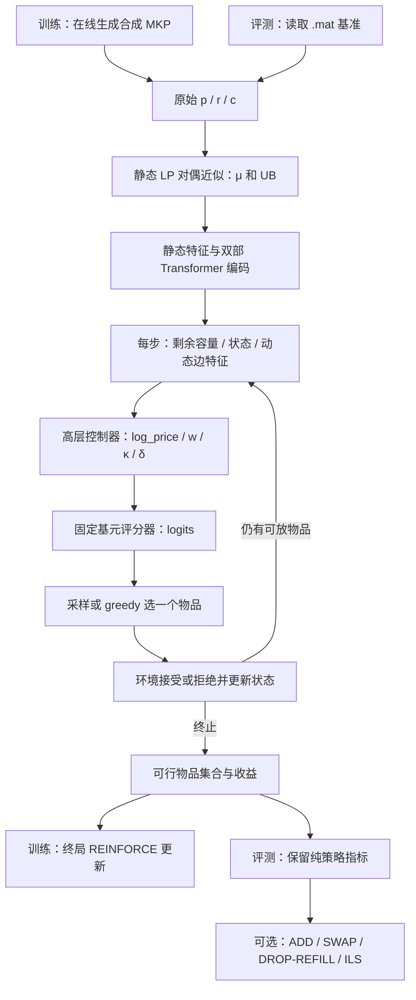

# 研究概览：Constrained_AwareMKP

本文面向后续开发人员和 AI 智能体，说明当前项目解决什么问题、采用什么路线，以及代码和本地实验已经支持哪些结论。精确的张量、公式和训练行为见 [ALGORITHM_DESIGN.md](ALGORITHM_DESIGN.md)。

核对日期：2026-10-23；分支：`main_v0`；代码提交：`e7d1def91236ac8bd0e73153a1f4504af695c6bd`。本次核对时已有的业务代码相对该提交没有修改；工作区已有的 `.gitignore` 修改不属于本文工作。以下实现结论以 Python 源码为准，实验结论以所列本地日志和 CSV 为准。源码链接行号对应本次快照，后续优先按类名、函数名定位。

## 1. 项目定位与研究背景

项目求解多维 0-1 背包问题（MKP）：给定物品收益 `p[N]`、资源消耗矩阵 `r[M,N]` 和容量 `c[M]`，选择物品集合，在全部资源约束内最大化总收益。这里没有空间装箱或物品几何信息；环境执行的是多约束下的集合选择。数学定义和数据结构分别位于 [mkp_env.py:6](../mkp_env.py#L6)、[MKPInstances](../mkp_env.py#L48)。

[README.md](../README.md) 将项目定位为组合优化中“结构感知与策略学习”的一个子课题，并提出 Chu 基准零样本平均 gap ≤ 0.1% 的目标。这是研究目标；当前是否达到，必须附带具体评测范围、采样预算和是否使用局部搜索，不能单独引用目标值。

当前路线把传统启发式中的资源价格、收益效率、剩余容量与学习模型结合：先用 LP 松弛对偶近似获得价格和上界，再用物品—资源双部 Transformer 理解当前剩余问题，由控制器输出评分策略，最后由无自身可训练参数的评分器选择一个物品。依据：[lp_dual](../mkp_env.py#L109)、[StateEncoder](../mkp_Model.py#L165)、[StrategyController](../mkp_Model.py#L202)、[WeakDecoder](../mkp_Model.py#L266)。

需要先记住三项实现事实：

- 当前训练算法是 **REINFORCE + 同实例多采样均值基线**，并非 PPO；没有 Critic、GAE、旧策略概率比或 PPO clipping。[MKPTrainer.train_step](../mkp_Trainer.py#L157)
- 当前策略不只有资源价格：控制器还输出混合权重 `w`、决断性 `κ` 和**逐物品可学习残差 `δ_j`**。`WeakDecoder` 自身无参数，并不意味着整个打分链路没有逐物品学习输出。[StrategyController.forward](../mkp_Model.py#L241)
- 默认基准包含多次策略采样和后处理搜索。纯策略指标 `gap_policy` 与加入搜索后的 `gap_final` 必须分开报告。[evaluate_instance](../Benchmark_zeroShot.py#L59)

## 2. 当前代码围绕的核心问题

| 核心问题 | 现有实现如何处理 | 当前证据边界 |
|---|---|---|
| 如何表示物品与多个资源的耦合？ | 物品、资源两类 token；消耗矩阵特征作为双向 cross-attention 的逐头 bias；同时使用两类 self-attention。 | 这是已有结构；未见独立消融证明某个注意力组件的收益。[DualAxisBlock](../mkp_Model.py#L121) |
| 如何感知当前剩余问题？ | 静态编码复用；每步注入容量、负载、溢出、可放状态、物品状态和进度，再运行控制器。 | 特征提供了直接可行性信息；“perceive”表示不强制用可行性 mask 过滤动作。[dynamic_features](../mkp_env.py#L307) |
| 如何以可解释参数控制选择？ | 资源价格调整、四种固定评分基元的混合、逆温度、逐物品残差共同决定 logits。 | 基元和变换可读；逐物品残差仍是学习分量，不能称为纯资源级控制。[WeakDecoder.__call__](../mkp_Model.py#L298) |
| 不使用可行性动作 mask 时如何确保最终解可行？ | 环境只接受当前可放的物品；不可放动作被丢弃并计惩罚，容量不变。 | 最终解的可行性由环境保证；低拒绝率才反映策略少做无效尝试。[MKPEnv.step](../mkp_env.py#L230) |
| 如何学习且不读入基准答案？ | 训练在线生成合成实例；终局收益以 LP 对偶上界归一化；同实例多轨迹构造基线。 | 当前训练调用链不读取 `.mat` 或 `best_known`；这不自动证明开发调参过程中没有使用过基准反馈。[train_step](../mkp_Trainer.py#L157) |
| 如何跨规模评估？ | 模型不使用固定 N/M 的输出向量头；默认训练 N=50/100/150、M=5/10，基准 N=100/250/500、M=5/10。 | 支持可变 N/M 的接口；更大 N 的本地结果见第 5 节，尚无本地 M=30 评测结果。[ModelConfig / EnvConfig](../mkp_config.py#L50) |
| 策略与传统搜索分别贡献多少？ | 基准同时保留单次 greedy、greedy+采样的最好值、加局部搜索后的最好值和固定 dual-greedy 参考。 | 可比较各阶段结果；现存结果不足以单独归因于架构、残差或资源价格。[Benchmark_zeroShot.py](../Benchmark_zeroShot.py#L169) |

## 3. 技术路线与完整数据流



图中训练更新对应 [MKPTrainer.train_step](../mkp_Trainer.py#L157)，决策循环对应 [ConstrainedMKPPolicy.forward](../mkp_Model.py#L336)，可选后处理仅由 [evaluate_instance](../Benchmark_zeroShot.py#L105) 调用。

### 3.1 实例与环境

在线生成器按代码注释中的 Chu–Beasley 风格生成正相关收益实例：`r_ij ~ U{0,...,1000}`，每个实例选一个 `α`，`c_i = ceil(α Σ_j r_ij)`，`p_j = max(1, floor(mean_i r_ij + 500 q_j))`。一个 batch 内 N、M 相同；一次训练 step 随机选一个 N 和一个 M。依据：[generate_instances](../mkp_env.py#L77)、[train_step](../mkp_Trainer.py#L159)。

每一步选择一个未处理物品。可放则装入、扣容量、加收益；不可放则标记拒绝。终止条件是“没有任何未处理且可放的物品”，不必处理完所有物品，也没有额外的 STOP 动作。容量单调减少，所以当前放不下的物品以后也放不下；这解释了拒绝此物品不会减少后续可行候选集，但不意味着早先装入的物品一定正确。依据：[MKPState](../mkp_env.py#L163)、[_refresh / step](../mkp_env.py#L224)。

### 3.2 感知、控制与评分

静态特征包括收益、消耗统计、LP 价格成本、reduced cost、价格比值排序；动态特征包括已选/已拒绝状态、当前可放性、剩余容量负载和剩余需求压力。静态编码每次 policy forward 只运行一次，随后共享给该次 forward 内同实例的多条轨迹。每一步从静态表示加当前动态特征重新计算控制器，未缓存上一步控制器隐状态。依据：[static_features / dynamic_features](../mkp_env.py#L269)、[StateEncoder](../mkp_Model.py#L165)、[ConstrainedMKPPolicy.forward](../mkp_Model.py#L347)。

控制器输出 `θ_t = (log_price_t, w_t, κ_t, δ_t)`。评分器把静态价格 `μ` 调整成正价格 `λ_t`，计算 `profit / efficiency / price_ratio / slack` 四个基元，逐基元在当前未处理物品上标准化，混合、乘 `κ`、加 `δ`。精确分母、截断、mask 和初始化见 [算法设计第 5—7 节](ALGORITHM_DESIGN.md#5-高层策略-θ-的含义与初始化)。

默认 `perceive` 不按可行性屏蔽动作，但模型输入明确包含 fits 和 overflow；另外始终存在“已处理物品”结构 mask。`soft_mask` 与 `hard_mask` 是配置中的对照模式。依据：[EnvConfig](../mkp_config.py#L62)、[WeakDecoder.__call__](../mkp_Model.py#L298)。

### 3.3 学习、验证与搜索

训练对每个实例采样 K 条完整轨迹，以 `profit/UB - reject_penalty * rejects/N` 为终局回报，减去同实例 K 条回报均值形成 advantage，优化完整轨迹 log-probability 并加熵正则。没有按时间步预测价值；LP 求解、环境转移和状态特征均不参与反向传播。依据：[get_reward](../mkp_env.py#L250)、[train_step](../mkp_Trainer.py#L157)。

验证使用独立固定随机种子 `20240607` 生成的合成集，默认 N=100、M=5/10，每种组合 64 个实例，执行单次 greedy，比较相对 LP 对偶上界的 gap。`best.pt` 按这个验证指标选取，不按 Chu CSV 选取。依据：[_build_val_set](../mkp_Trainer.py#L113)、[validate / fit](../mkp_Trainer.py#L210)。

评测不更新网络；同一实例运行一次 greedy 和默认 256 次采样，再把前 16 个不同集合送入可选局部搜索。搜索用静态 LP 价格比值填充，并执行 1-1 交换、低比值物品的 drop-refill 和 100 轮 ILS。搜索既不回传梯度，也不进入当前训练回报。依据：[evaluate_instance](../Benchmark_zeroShot.py#L59)、[local_search / iterated_local_search](../mkp_refine.py#L123)。

## 4. 代码地图与默认实验设置

| 文件 | 入口或核心符号 | 负责的契约 |
|---|---|---|
| [mkp_config.py](../mkp_config.py) | `Config`, `get_config`, `apply_overrides`, `resolve_path` | 集中默认值；`--section.field value`；项目根目录相对路径解析。 |
| [mkp_env.py](../mkp_env.py) | `MKPInstances`, `lp_dual`, `MKPState`, `MKPEnv` | 原始数据、LP 对偶、环境转移、固定特征和参考启发式。 |
| [mkp_Model.py](../mkp_Model.py) | `StateEncoder`, `StrategyController`, `WeakDecoder`, `ConstrainedMKPPolicy` | 表示学习、θ、固定评分公式和整条 rollout。 |
| [mkp_Trainer.py](../mkp_Trainer.py) | `MKPTrainer`, `load_policy` | REINFORCE 更新、验证、日志、checkpoint 保存与加载。 |
| [train_ConstrainedMKP.py](../train_ConstrainedMKP.py) | `main` | 解析参数、设种子、选设备并调用 `fit()`。 |
| [Benchmark_zeroShot.py](../Benchmark_zeroShot.py) | `main`, `evaluate_instance` | 加载模型、过滤基准、纯策略与搜索结果、逐实例和分组 CSV。 |
| [mkp_refine.py](../mkp_refine.py) | `greedy_fill`, `swap_11`, `drop_refill`, `iterated_local_search` | 评测后处理；自身无学习参数。 |
| [read_mat.py](../read_mat.py) | `read_mat`, `read_GK` | 两种 `.mat` 字段布局的解析；当前 benchmark 主入口只调用 `read_mat`。 |

| 类别 | 默认值 | 代码来源 |
|---|---|---|
| 数据 | N∈{50,100,150}；M∈{5,10}；α∈{0.25,0.5,0.75} | [EnvConfig](../mkp_config.py#L50) |
| 模型 | D=128；8 heads；静态 3 层；动态控制器 2 层；dropout=0 | [ModelConfig](../mkp_config.py#L81) |
| 策略头 | 价格 log 调整范围 ±3；price floor=0.05；κ 初值 3、下界 0.1；残差幅度 3 | [ModelConfig](../mkp_config.py#L97) |
| 更新预算 | 100 epochs × 250 steps；每步 B=64，每实例 K=16 条轨迹 | [TrainConfig](../mkp_config.py#L111) |
| 优化 | Adam；lr=1e-4；warmup=500；余弦降至 1e-6；grad clip=1；熵系数 0.01 | [TrainConfig](../mkp_config.py#L118) |
| 设备 | 优先 cuda:1；不存在该卡则 cuda:0；无 CUDA 则 CPU；CUDA 默认 bf16 autocast | [get_device](../mkp_config.py#L260)、[policy.forward](../mkp_Model.py#L344) |
| 基准 | Chu；N∈{100,250,500}；M∈{5,10}；每实例 1 greedy + 256 samples | [EvalConfig](../mkp_config.py#L143) |
| 后处理 | 默认开启；16 个不同起点；局部搜索最多 200 轮；drop 候选 32；ILS 100 轮 | [EvalConfig](../mkp_config.py#L156) |

## 5. 本地已有进展与可引用结果

本节是对本次工作区已保存文件的读取与重新汇总，没有重新训练或重跑基准。这些文件未被当前 Git 跟踪；换一份 clone 时可能不存在。训练日志记录的运行路径在 Linux 下，不能把这些时间数据当成本次 Windows 环境的实测。当前提交与历史运行间没有完整的代码/数据/checkpoint SHA 清单，以下是现存记录支持的结果，尚非逐位复现实验证明。

### 5.1 已有一次完整训练记录

来源：[运行配置](../runs/20261021_164411/config.json)、[train_log.csv](../runs/20261021_164411/train_log.csv)、[val_log.csv](../runs/20261021_164411/val_log.csv)、[log.txt](../runs/20261021_164411/log.txt)。

| 项目 | 现存记录 |
|---|---|
| 运行名 | `20261021_164411` |
| 训练预算 | 25,000 条 step 记录、100 条 epoch 验证记录，与 100×250 配置一致。 |
| 最好验证 | CSV `epoch=63, step=16000`，平均 gap-to-LP = **1.533432%**。 |
| 最好点分组 | N100/M5 = 1.134785%；N100/M10 = 1.932080%；两组平均。 |
| 结束点 | CSV `epoch=99, step=25000`，平均 gap-to-LP = 1.545244%。 |
| checkpoint 名中的 epoch | 保存前执行 `self.epoch=ep+1`，因此 CSV epoch=63 对应 checkpoint epoch=64。[fit](../mkp_Trainer.py#L260) |

这里的 gap 比较对象是近似 LP 对偶上界，并非整数最优值或 Chu best-known，不能与下一节的百分比直接比较，也不能仅由训练结束断言已经收敛。

### 5.2 已有一次 Chu 零样本评测记录

来源目录：[20261022_231334_20261021_164411_ep64](../results/20261022_231334_20261021_164411_ep64/)；其中 [config.json](../results/20261022_231334_20261021_164411_ep64/config.json) 记录默认 256 次采样和已开启的搜索预算，[per_instance.csv](../results/20261022_231334_20261021_164411_ep64/per_instance.csv) 有 180 个不同实例 ID，[summary.csv](../results/20261022_231334_20261021_164411_ep64/summary.csv) 保留分组和 overall。

基准 gap 定义：`100 * (best_known - objective) / best_known`。以下均为逐实例百分比的算术平均，不是合计收益后再计算的 gap。

| 指标 | 180 实例平均 gap | 含义 |
|---|---:|---|
| `gap_dual_greedy` | 0.711241% | 固定静态 LP 价格比值的单次 greedy。 |
| `gap_greedy` | 0.439210% | 已训练策略的单次 greedy。 |
| `gap_policy` | **0.244037%** | 一次 greedy 与 256 次策略采样中的最好收益；无局部搜索。 |
| `gap_final` | **0.074213%** | 策略候选再经 ADD/SWAP/DROP-REFILL/ILS 后的最好收益。 |

| M | N | 实例数 | `gap_policy` | `gap_final` |
|---:|---:|---:|---:|---:|
| 5 | 100 | 30 | 0.373411% | 0.058380% |
| 5 | 250 | 30 | 0.130714% | 0.066462% |
| 5 | 500 | 30 | 0.058875% | 0.030961% |
| 10 | 100 | 30 | 0.554247% | 0.114403% |
| 10 | 250 | 30 | 0.229980% | 0.097507% |
| 10 | 500 | 30 | 0.116996% | 0.077564% |

因此，在这一次保存的 180 实例评测、上述预算下，**策略加搜索**的 overall 达到 README 所述 0.1% 数值目标；**纯策略 overall 尚未达到**。M10/N100 的纯策略和最终 gap 都高于 overall，值得单独观察，但不能据此判断具体模型部件的原因。

同一 summary 另有：最终结果 24/180 条 `gap_final <= 1e-9`，表示达到或超过文件中的 best-known；没有整数最优性证书。单实例平均记录耗时 4.396621s，其中 policy 阶段 3.335584s、refine 阶段 1.061036s；policy 计时包含 LP 和 dual-greedy 参考计算，不是纯网络延迟。来源：[summary.csv](../results/20261022_231334_20261021_164411_ep64/summary.csv)、[evaluate_instance](../Benchmark_zeroShot.py#L62)。

### 5.3 当前不能从这些记录推出的结论

- 不能把 `gap_final` 称为“弱解码器单次推理效果”：它包含多采样和显式搜索。
- 不能称为“PPO 训练结果”：现存代码和日志配置对应 REINFORCE。
- 不能将 LP 对偶上界当作整数最优解，或将 `n_optimal_final` 当作求解器最优性认证。
- 不能宣称双部结构、动态价格、某个基元或逐物品残差单独导致了收益：当前工作区没有这些部件的配对消融结果。
- 没有本地多种子汇总、M=30 结果、GK 等其他家族的完整评测记录；文件存在或接口支持不能代替实测。

这些限制分别来自现有训练目标、评测调用链、结果文件范围，以及仓库尚无独立消融入口和正式测试套件的现状。

## 6. 接手项目时的操作与注意事项

以下命令由现有 CLI 支持；训练/评测命令展示调用方式，本次文档工作没有执行它们。依赖声明见 [requirements.txt](../requirements.txt)。相对数据、日志和 checkpoint 路径由 `resolve_path()` 按项目根目录解析。

```powershell
# 查看当前配置，不创建训练任务。
python train_ConstrainedMKP.py --print_config
python Benchmark_zeroShot.py --print_config

# 正式训练；按实际设备修改 cuda_device。
python train_ConstrainedMKP.py --device.cuda_device 0

# 续训：epochs 是目标总轮数；模型和原训练配置需自行保持兼容。
python train_ConstrainedMKP.py --train.resume checkpoints/last.pt --train.epochs 150

# 只评估策略 greedy + sampling，不调用后处理。
python Benchmark_zeroShot.py --checkpoint checkpoints/best.pt --eval.ls_enable false

# 评估策略加默认后处理；仅启发式参考使用 --baseline_only。
python Benchmark_zeroShot.py --checkpoint checkpoints/best.pt
python Benchmark_zeroShot.py --baseline_only
```

开发前优先核对这些契约：

1. **算法名称与状态输入。** PPO 尚未实现；修改特征顺序或维度时，同步环境特征常量、模型输入层及文档。[feature sizes](../mkp_env.py#L357)
2. **checkpoint 的加载方式。** 训练 resume 使用本次 CLI/default 配置先建模型，再恢复权重、优化器、调度器和进度，不自动恢复 checkpoint 配置或 RNG。评测反而以 checkpoint 的 model/env 配置为准，只覆盖 eval/device。详见 [算法设计第 10 节](ALGORITHM_DESIGN.md#10-配置checkpoint-与恢复语义)。
3. **数据家族。** `Benchmark_zeroShot.py` 固定调用 `read_mat`；GK 有独立 `read_GK`，不能仅换 `--eval.mat_file` 就假定所有格式通用。[read_mat.py](../read_mat.py#L40)
4. **指标名。** `sample_feasible_pick_rate` 实际是 `1-mean(rejects/N)`；`steps` 是同批最长轨迹长度。它们都不等于每条轨迹真实有效动作数，精确定义见 [算法设计第 9 节](ALGORITHM_DESIGN.md#9-推理评测与后处理边界)。
5. **复现材料。** 当前 checkpoint 没有保存 RNG 状态、环境版本和源码/数据 SHA；当前评测 JSON 也未完整保存有效的 checkpoint model/env 配置。继续研究时应随结果另存这些信息，再做匹配比较。[MKPTrainer._state](../mkp_Trainer.py#L129)、[benchmark.main](../Benchmark_zeroShot.py#L140)

以上是现有实现需要理解的限制，不表示本次已经修改训练器、评测器或模型。

## 7. 开发方向与文档维护规则

下表是从当前接口和证据缺口推导的后续工作建议，**不是已实现功能或已得到的结果**。

| 后续问题 | 可从哪里接入 | 需要补充的证据 |
|---|---|---|
| 弄清各学习分量贡献 | `ModelConfig.primitives`、`residual_max`、价格头、静态/动态编码层 | 匹配训练预算、实例和种子的消融；残差关闭需用兼容配置重新构建/训练。 |
| 分开测量策略质量与搜索成本 | `EvalConfig` 的采样数、`ls_enable`、pool、ILS 轮数 | 同一 checkpoint 的 greedy、采样、搜索预算曲线；报告各阶段时间。 |
| 如确需引入 PPO | 训练器与 policy 的动作概率接口 | 当前只有整条轨迹汇总概率；需新增逐步状态/动作/旧 log-prob、价值/advantage、重算概率和 clipped objective，不能只改类名。 |
| 扩展到其他基准或资源数 | `EvalConfig` 过滤、数据 parser、模型可变 N/M 接口 | 格式检查、可行性检查、独立基准结果；不能复用 Chu 结果作证明。 |
| 补足可复现性 | `_state()`、评测 `config.json`、运行输出目录 | 有效配置、数据与 checkpoint SHA、源码版本、RNG 与环境版本。 |

更新实现时，应同时维护这两份文档中的符号、特征顺序、默认值和指标口径；新增实验只替换第 5 节中带来源的记录。若文档与代码冲突，先核对当前类/函数实现，再修正文档，避免沿用 README 中省略的公式或其他仓库的设计。
